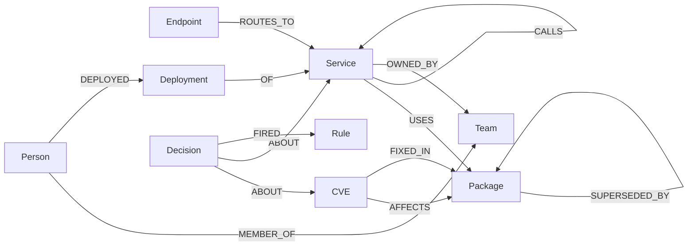

# Blast Radius

**An agent that triages software supply-chain vulnerabilities by reasoning over
a FalkorDB graph.**

Give it a CVE ID and it:

1. finds every service that pulls in the vulnerable package, through any number
   of transitive dependencies;
2. works out whether each one is reachable from the public internet;
3. ranks them by risk (severity × exposure × criticality);
4. finds the owning team;
5. simulates candidate fixes in a sandbox copy of the graph;
6. acts: opens tickets, notifies owners, proposes fix PRs.

Every action is backed by a graph path that is re-checked edge by edge before
anything happens. No verified proof, no action.

*Track 01: Agents That Act on Connected Data.*

```
Ingestion jobs -> FalkorDB <-> MCP server <-> Agent (LLM) -> Action tools
                      ^                            |
                      +---- Web UI (ranked list, paths, simulation, action log)
```

## How it covers the track

| Focus | Where |
|-------|-------|
| Multi-hop reasoning | Package → package → service → service → public endpoint chains, up to 6 hops ([benchmark](#evaluation)) |
| Graph queries and algorithms as tools | 15 MCP tools, all parameterized Cypher in [`queries/`](queries/), including PageRank and betweenness |
| Tool selection through MCP | `agent.mcp_agent` discovers tools with `list_tools`; Claude picks each next call and gives a reason |
| Actions based on the graph | Tickets, owner notifications and fix PRs, each refused without a verified proof path |
| Explainable results | Every verdict cites the rules that fired plus two proofs: the dependency path and the public route |

## Quick start

Needs Docker (with Compose) and Python 3.10+.

```bash
git clone https://github.com/ruck-syu/blast-radius && cd blast-radius
cp .env.example .env              # optional keys, see Configuration
docker compose up -d              # FalkorDB on localhost:6379
pip install -r requirements.txt

python -m ingest.generate --all   # two synthetic orgs (dev seed 42, held-out seed 1337)
python -m ingest.load --all       # ~22k nodes / ~39k edges per graph
python -m ingest.verify --org dev && python -m ingest.verify --org heldout

python -m ui.server               # http://127.0.0.1:8765
```

Then try a triage from the terminal:

```bash
python -m agent.triage CVE-2021-44228
```

Everything works without API keys. Without them, actions run in dry-run mode
(the guardrail is still enforced), and the agent uses the offline planner
instead of Claude.

## What you can do

### Triage a CVE

```bash
python -m agent.triage CVE-2021-44228 [--org heldout] [--json] [--compare-fixes]
```

Every reachable service gets two proofs, each verified edge by edge:

- **Dependency proof:** service → … → vulnerable package → CVE.
- **Exposure proof:** the shortest public route
  (`Endpoint -ROUTES_TO-> Service -CALLS->* Service`), starting from an
  endpoint that is checked to be public.

Together they give the full attack chain: internet → service → vulnerable
package → CVE.

### Let Claude investigate over MCP

```bash
python -m agent.mcp_agent CVE-2021-44228 [--org heldout] [--allow-actions]
python -m agent.mcp_agent --question "Is d-checkout-api exposed to CVE-2021-44228, and how does public traffic reach it?"
python -m agent.mcp_agent CVE-2021-44228 --offline    # no API key needed
```

`agent.mcp_agent` is an MCP client. It starts the server over stdio, discovers
the tools, and lets Claude choose each next call based on what the graph has
returned so far. Each call is printed with a one-line reason.

Claude's answers are not taken on trust:

- each verdict is re-derived from the `evaluate_rules` output Claude saw;
- each proof path is verified edge by edge;
- any disagreement is flagged.

Needs `ANTHROPIC_API_KEY` (model `LLM_MODEL`, default `claude-opus-5-5`).

`--offline` replaces Claude with [`agent/offline_planner.py`](agent/offline_planner.py),
a fixed sequence of tool calls rather than a model: `get_cve`, `score_risk`,
`evaluate_rules` per service, `find_owner` for ACT_NOW services,
`rank_criticality`, then verdicts from the rules. It goes through the same MCP
client and the same checks, so the loop runs without a key and gives a baseline
to compare Claude's tool choices against.

### Act on the findings

```bash
python -m agent.act CVE-2021-44228 [--verdicts ACT_NOW] [--pr]
```

Every action tool (`create_ticket`, `notify_owner`, `open_fix_pr`) refuses
unless it gets a proof path whose every edge exists in the graph.

`open_fix_pr` adds a second check. It applies the upgrade to a sandbox copy
first, and refuses unless the upgrade:

- resolves that CVE for that service, and
- opens no new ACT_NOW exposure.

For example, pinning `xz@5.6.1` as a "fix" for log4j is refused, naming
CVE-2024-3094. The sandbox result goes into the PR body. If the target version
still carries other CVEs, the PR gets a warning: with CVE-2018-11776 imported
from OSV, upgrading struts to 2.5.10.1 fixes CVE-2017-5638 but stays ACT_NOW
because of the KEV-listed CVE-2018-11776.

### Check a change before it merges

The pre-merge gate applies a proposed change to a sandbox copy of the graph,
re-scores every CVE, and fails on new ACT_NOW exposure, including exposure
pulled in transitively. Here a PR makes `d-billing-worker` depend on a
package that pulls in log4j-core 2.14.1 two hops down:

```bash
python -m agent.gate --service d-billing-worker --adds pkg:npm/syn-d-pkg-03519@1.19.5
# ## Blast Radius pre-merge check: FAIL: new ACT_NOW exposure
# | CVE-2021-44228 | d-billing-worker | not affected → ACT_NOW | public via /api/d/v1/route-02; ... |
# exit 1
```

In CI, give it the CycloneDX SBOMs (from syft, cdxgen or similar) of the base
branch and the PR branch. Upgrades are credited with what they fix:

```bash
python -m agent.sbom d-recommend-api > base.cdx.json     # stand-in for syft, built from the graph
python -m agent.sbom d-recommend-api \
  --drop pkg:maven/org.apache.logging.log4j/log4j-core@2.14.1 \
  --add  pkg:maven/org.apache.logging.log4j/log4j-core@2.17.1 > pr.cdx.json
python -m agent.gate --sbom-before base.cdx.json --sbom-after pr.cdx.json
# ## Blast Radius pre-merge check: PASS: no new exposure, resolves 1
# - CVE-2021-44228 on `d-recommend-api`: was ACT_NOW, no longer affected
```

How the SBOM diff is read:

- The service name comes from `metadata.component.name`.
- Components only in the PR SBOM are **adds**. New direct dependencies are
  processed first, so the rest of a flattened subtree is recognised as pulled
  in and the report shows the real transitive chain.
- Components only in the base SBOM are **removes**. A (CVE, service) pair
  survives only if some dependency path avoids every removed version.

Other options: `--adds`/`--removes PURL...` instead of SBOMs, `--expose PATH`
for a new public route, `--fail-on SCHEDULE` to be stricter, and `--json` for
tooling. The live graph is never written; each run uses its own sandbox and
deletes it.

[`examples/ci/blast-radius-gate.yml`](examples/ci/blast-radius-gate.yml) is a
GitHub Actions workflow for a service repo. It builds SBOMs of the base and PR
branches with syft, runs the gate, posts the report as a sticky PR comment,
and fails the check on new ACT_NOW.

### Import real advisories

```bash
python -m ingest.osv CVE-2021-45046 [--org heldout] [--dry-run]   # one advisory from OSV.dev
python -m ingest.osv --scan --dry-run                             # every advisory for the graph's real packages
```

The advisory's version ranges are matched against the package versions in the
graph. Imported CVEs are triaged like any other.

### See the whole org at once

```bash
python -m agent.posture [--org heldout] [--limit 10] [--json]
```

Rolls every CVE up two ways: vulnerable packages ranked by how many ACT_NOW
(CVE, service) pairs an upgrade would clear, and services ranked by ACT_NOW
count.

### Try "what if" changes on the live graph

```bash
python -m agent.live expose d-notify-svc                      # give a service a public route
python -m agent.live adopt d-search-api --cve CVE-2021-44228  # make it use the vulnerable package
python -m agent.live list
python -m agent.live revert                                   # remove exactly those changes
```

## Web UI

Run `python -m ui.server`, then open http://127.0.0.1:8765.

| Panel | What it shows |
|-------|---------------|
| **Blast map** | Layered graph: public endpoints → affected services → dependency chain → vulnerable package → CVE. Hover a service to trace its paths; click to inspect. |
| **Ranked services** + **Why** | Verdict, risk, rules, owner, and the attack chain with both proofs marked verified. |
| **Investigate with Claude** | The MCP agent's trace streamed live (tool, reason, what came back), then a findings table showing whether each verdict agrees with the rules and its proof verified. *Approve* acts only on ACT_NOW findings that pass both checks. Without a key, *Offline planner (no model)* runs the same loop and checks, clearly labelled. |
| **Live change** | Expose a service or make it adopt the vulnerable package. *Check in sandbox* predicts the result the way the pre-merge gate does; *Apply* changes the live graph, re-triages and shows what flipped (e.g. SCHEDULE → ACT_NOW). *Revert* removes exactly those changes. |
| **Import from OSV.dev** | Offered when you triage a CVE that isn't in the graph; it is triaged as soon as it lands. |
| **Org posture** | Packages ranked by the ACT_NOW pairs an upgrade would clear, with the upgrade target and whether that target is itself affected; services ranked by ACT_NOW count, each CVE linking into triage. |
| **Fix simulation**, **Actions**, **Decisions**, **Action log** | Compare upgrades, open tickets and notify owners, run a guardrail drill with a forged proof, and browse the decisions recorded in the graph. |

The HTTP API is documented in the `ui/server.py` docstring.

## Where it fits in a team's workflow

| When | Run | What happens |
|------|-----|--------------|
| A PR changes dependencies or routes | `agent.gate` in CI | The change is checked in a sandbox; new ACT_NOW exposure fails the check with a PR comment |
| A new CVE lands | `ingest.osv <id>` (or `--scan` on a schedule), then triage | Blast radius, public routes, verdicts and owners, each with a verified proof |
| Verdicts are in | `agent.act`, or *Approve* in the UI | Tickets and owner notifications, refused without a verified proof |
| Choosing what to fix first | *Simulate fixes* / `simulate_fix`, or `agent.posture` | Each upgrade re-scored in a sandbox; the biggest org-wide risk drop wins |
| Ad-hoc questions | Claude Code, or any MCP client | The same graph tools; the model picks which to call |

Opening this repo in Claude Code offers the `blast-radius` MCP server from
`.mcp.json` (approve it once). Other MCP clients run
`python -m mcp_server.server` from the repo root over stdio.

## Configuration

All keys are optional and go in `.env`, which is read at startup. Real
environment variables take precedence.

| Variable | Enables |
|----------|---------|
| `FALKORDB_HOST`, `FALKORDB_PORT`, `FALKORDB_USERNAME`, `FALKORDB_PASSWORD` | A different FalkorDB, e.g. FalkorDB Cloud (default: local Docker) |
| `ANTHROPIC_API_KEY` (or `OPENAI_API_KEY`), `LLM_PROVIDER`, `LLM_MODEL` | Claude choosing tools in *Investigate* and `agent.mcp_agent`; LLM wording for summaries |
| `GITHUB_TOKEN` + `DEMO_REPO` | Real GitHub issues, on our own demo repo only |
| `SLACK_WEBHOOK` | Real owner notifications |

## Testing

```bash
python check.py          # every acceptance suite, one PASS/FAIL line each
python check.py gate ui  # only suites whose name contains one of the words
```

| Suite | Covers |
|-------|--------|
| `mcp_server.test_tools` | Read tools against ground truth |
| `agent.test_agent` | End-to-end triage |
| `agent.test_simulation` | Fix comparison |
| `agent.test_actions` | Guardrail accept/refuse, sandbox-checked fix PRs |
| `mcp_server.test_apply` | Incremental updates and revert |
| `agent.test_mcp_agent` | MCP agent: tool discovery, trace, verdict and proof checks (scripted model, no key) |
| `agent.test_gate` | Pre-merge gate: sandbox, transitive pulls, upgrades, SBOM diff, live graph untouched |
| `ingest.test_osv` | OSV import: version ranges, CVSS, triage on an imported CVE (saved records, no network) |
| `ui.test_ui` | UI API: triage, streamed investigate, approve, refusal drill, live change |

Run any suite on its own with `python -m <suite>`. The benchmark runs
separately: `python -m benchmark.runner --org all`.

Tests that act write to a temporary action log and delete the Decision nodes
they create. Before recording a demo, `python -m agent.reset_demo` clears all
Decision nodes, live changes, OSV imports and the action log.

## Graph data model



| Node | Key properties |
|------|---------------|
| `CVE` | `id`, `cvss`, `epss`, `in_kev`, `summary`, `published` |
| `Package` | `name`, `version`, `ecosystem`, `purl` |
| `Service` | `name`, `tier` (critical/standard/internal), `repo`, `language` |
| `Endpoint` | `path`, `public` |
| `Team` | `name`, `slack_channel` |
| `Person` | `name`, `handle` |
| `Deployment` | `id`, `timestamp`, `version` |
| `Rule` | `id` (`R_KEV`, `R_PUBLIC_REACH`, `R_CRITICAL_TIER`, `R_NO_REACH`, `R_FIX_AVAILABLE`), `weight` |
| `Decision` | `id`, `timestamp`, verdict (`ACT_NOW`/`SCHEDULE`/`SUPPRESS`), `rationale`, `proof_path` (node-id list) |

Indexes on `CVE.id`, `Package.purl` and `Service.name`. Scale: 22,234 nodes /
39,096 edges (dev), 22,240 / 39,214 (held-out). Full definitions in
[`docs/data-model.md`](docs/data-model.md).

## Queries and tools

Every query lives in its own file in [`queries/`](queries/), with a one-line
comment saying what it does. The agent never writes free-form Cypher against
the live graph. Depth limits are validated as integers and then written into
the query text, because FalkorDB doesn't accept variable-length bounds as
parameters.

**MCP tools:** `get_cve`, `find_affected_services`, `check_reachability`,
`dependency_path`, `rank_criticality`, `find_owner`, `score_risk`,
`evaluate_rules`, `simulate_fix`, `assess_change`, `org_posture`,
`apply_change`, `create_ticket`, `notify_owner`, `open_fix_pr`.

**Graph algorithms:** `rank_criticality` runs FalkorDB's `algo.pageRank` and
exact `algo.betweenness` over the CALLS graph; triage cites each affected
service's rank.

**Query groups:**

| Group | Queries |
|-------|---------|
| Core traversals | `find_affected_services`, `check_reachability`, `dependency_path`, `score_risk` (risk formula), `evaluate_rules` (named rules), `rank_criticality` |
| Guardrail | `verify_edge`, `verify_path_start`, `verify_path_cve_anchor`, `write_decision` |
| Simulation | `upgrade_path`, `upgrade_uses`, `upgrade_depends`, `remove_fixed_affects` |
| Live changes | `apply_*`, `list_live_changes`, `revert_live_*` |
| Pre-merge checks | `package_exists`, `service_resolves`, `dependency_path_avoiding`, `service_sbom` |
| Advisory import | `real_packages`, `packages_by_purl_prefix`, `cve_source`, `import_cve`, `import_fix_link`, `remove_imported_cve`, `prune_imported_upgrades` |
| Posture | `cves_affecting` |
| UI helpers | `get_cve`, `list_cves`, `list_services`, `list_decisions`, `call_graph_edges` |

## Evaluation

### Why the graph is essential

Held-out benchmark, 27 questions across 1-hop, 2–3-hop, 4–6-hop and
counterfactual:

| System | Overall | 4–6-hop | Path validity |
|--------|---------|---------|---------------|
| Agent (parameterized tools, depth-bounded) | **0.998** | 1.000 | **1.000** |
| Unbounded-Cypher proxy | 0.632 | 0.579 | never cites |
| Flat lexical tables | 0.293 | **0.000** | never cites |
| Agent with the graph removed (ablation) | **0.000** | 0.000 | — |

Flat retrieval answers single lookups but can't see past one hop. Unbounded
Cypher gets worse as hop count rises and cites no verifiable paths. Removing
FalkorDB breaks everything (27 of 27 questions error). Full results and
metrics: [`benchmark/results/SUMMARY.md`](benchmark/results/SUMMARY.md).

### Methodology

- **Ground truth** (which services are truly affected, truly reachable, and the
  best fix per org) is planted by the seeded generator into
  `benchmark/ground_truth.json`.
- **Questions:** `benchmark/questions.py` derives 27 per org.
- **Scoring:** `benchmark/runner.py` scores three systems on the same
  questions: scalar accuracy, set precision/recall, ranked P@k and MRR (with
  reachability as relevance), endpoint accuracy, and edge-by-edge path
  validity.
- **Baselines** are documented stand-ins that don't use an LLM (lexical SQLite;
  unbounded-Cypher templates). `--writer llm` swaps in a real LLM when a key is
  set.
- **No tuning** on either org; thresholds were set before the benchmark
  existed. CVE IDs are the same in both orgs by design, but the held-out graph
  is unseen.

It is a small benchmark, so the claims are modest. Details:
[`benchmark/METHODOLOGY.md`](benchmark/METHODOLOGY.md).

## Data statement

All data is public or synthetic.

- **Public:** CVE and advisory metadata (IDs, CVSS, summaries) and real package
  names and versions for the three vulnerable/fixed pairs. `ingest.osv` imports
  public advisories from OSV.dev, with CVSS computed from the v3 vector, KEV
  status from the CISA catalog and EPSS from FIRST. Imports are tagged
  `source: 'osv'`, never overwrite seeded CVEs, and are removed by
  `agent.reset_demo`.
- **Synthetic** (labelled `synthetic:true`, fictional people and teams):
  services, endpoints, package dependency edges, teams, people, deployments.
- No private, login-protected, paywalled or personal data.

There are two separate graphs, `blast_radius_dev` (seed 42) and
`blast_radius_heldout` (seed 1337), so held-out evaluation really is unseen.

## Deliverables

- [x] Public source repository (this repo)
- [x] Complete local setup, with FalkorDB Cloud supported through `.env` (see [Quick start](#quick-start))
- [ ] Demo video, to be recorded from [`docs/demo-script.md`](docs/demo-script.md) (7 steps, ~6 min)

More: [`DECISIONS.md`](DECISIONS.md) (design choices and what was rejected),
[`AI_USAGE.md`](AI_USAGE.md) (every AI tool used and for what).

## Related work

- **FalkorDB `GRAPH.COPY`:** a server-side clone including indexes; the
  destination must not exist and the source stays readable. Checked against the
  [official docs](https://docs.falkordb.com/commands/graph.copy) and by
  measurement (89 ms to clone the 22k-node graph). It is the basis of
  `simulate_fix` and every sandbox check.
- **FalkorDB command and Cypher reference:** Redis-protocol `GRAPH.QUERY`, an
  OpenCypher subset, no Bolt. From the
  [official docs](https://docs.falkordb.com/commands); the reason for one query
  per file and for only calling procedures confirmed to exist.
