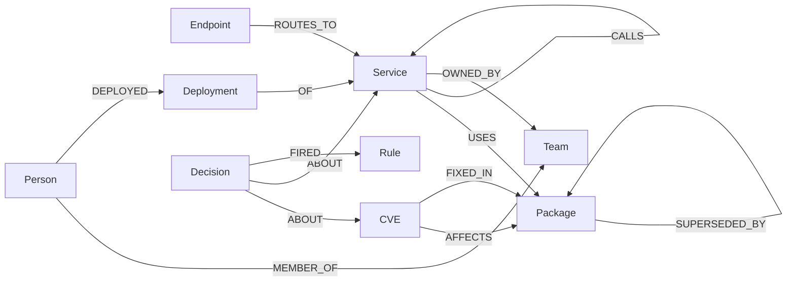

# Blast Radius

Agent that triages software supply-chain vulnerabilities by reasoning over a
**FalkorDB** graph. Given a CVE ID it finds every affected service through
transitive dependencies, determines public reachability, ranks by
risk (severity × exposure × criticality), identifies owners, simulates fixes
in sandbox graph copies, and acts — every action backed by a verified graph
path as proof.

**Track 01, Agents That Act on Connected Data.** Full build spec is
`blast-radius-build-spec.md` (parent directory, not part of the submission).

```
Ingestion jobs -> FalkorDB <-> MCP server <-> Agent (LLM) -> Action tools
                      ^                            |
                      +---- Web UI (ranked list, paths, simulation, action log)
```

## Setup (fresh machine)

Prerequisites: Docker + Docker Compose, Python 3.10+.

```bash
git clone <this-repo> && cd blast-radius
cp .env.example .env            # optional: add LLM / GitHub / Slack keys (see below)
docker compose up -d            # FalkorDB on localhost:6379
pip install -r requirements.txt
python -m ingest.generate --all # two synthetic orgs, canonical seeds (dev 42, held-out 1337)
python -m ingest.load --all     # ~22k nodes / ~39k edges per graph
python -m ingest.verify --org dev && python -m ingest.verify --org heldout
```

Verify each phase (all must print ALL PASS / ACCEPTANCE PASS):

```bash
python -m mcp_server.test_tools      # Phase 2: read tools vs ground truth
python -m agent.test_agent           # Phase 3: end-to-end triage
python -m agent.test_simulation      # Phase 4: fix comparison
python -m agent.test_actions         # Phase 5: guardrail accept/refuse
python -m mcp_server.test_apply      # incremental updates + revert
python -m agent.test_mcp_agent       # MCP agent: tool discovery, trace, verdict/proof checks (scripted LLM, no key)
python -m ui.test_ui                 # UI API: triage, SSE investigate, approve, refusal drill
python -m benchmark.runner --org all # Phase 7: 3 systems, held-out numbers
python -m ui.server                  # Phase 6: http://127.0.0.1:8765
```

Tests that act write to a temp action log and delete the Decision nodes they
create. `python -m agent.reset_demo` clears all Decision nodes, live changes
and the action log before a demo recording.

Live deployment: point the env at FalkorDB Cloud or any self-hosted instance
(`FALKORDB_HOST/PORT/USERNAME/PASSWORD` in `.env`) — no code changes needed;
`docker compose` is just the default local backend. Optional live wires:
`LLM_PROVIDER` + `ANTHROPIC_API_KEY`/`OPENAI_API_KEY` (summary wording),
`GITHUB_TOKEN` + `DEMO_REPO` (real tickets on our own demo repo),
`SLACK_WEBHOOK` (real notifications). Without them the product runs fully in
dry-run/template mode with the guardrail enforced. `.env` is read at startup
(real environment variables win), so keys put there reach every entry point.

## Usage

```bash
python -m agent.triage CVE-2021-44228 [--org heldout] [--json] [--compare-fixes]
python -m agent.act CVE-2021-44228 [--verdicts ACT_NOW] [--pr]
python -m agent.mcp_agent CVE-2021-44228 [--org heldout] [--allow-actions]  # Claude picks tools over MCP
python -m agent.mcp_agent --question "Is d-checkout-api exposed to CVE-2021-44228, and how does public traffic reach it?"
python -m agent.live expose d-notify-svc | adopt d-search-api --cve CVE-2021-44228 | list | revert
python -m mcp_server.server   # MCP stdio transport for external clients
```

`agent.mcp_agent` is an MCP client: it spawns the server over stdio, discovers
the tools with `list_tools`, and Claude chooses each next call from what the
graph returned so far, giving a one-line reason per call (printed as the trace).
Verdicts it submits are re-derived from the `evaluate_rules` output it saw, and
each service's proof path is verified edge by edge; disagreements are flagged.
Needs `ANTHROPIC_API_KEY` (model `LLM_MODEL`, default `claude-opus-5-5`).

Every reachable service also gets an **exposure proof**: the shortest public
route (`Endpoint -ROUTES_TO-> Service -CALLS->* Service`), verified edge by
edge like the dependency proof, with the start checked to be a public endpoint.
Together the two proofs are the full attack chain: internet → service →
vulnerable package → CVE.

### Web UI

`python -m ui.server`, then http://127.0.0.1:8765:

- **Blast map**: layered graph of public endpoints → affected services →
  dependency chain → vulnerable package → CVE. Hover a service to trace its
  paths, click to inspect.
- **Ranked services** + **Why**: verdict, risk, rules, owner, and the attack
  chain with both proofs marked verified.
- **Investigate with Claude**: streams the MCP agent's trace live (tool, reason,
  digest of what came back) over Server-Sent Events, then a findings table
  showing whether each verdict agrees with the rules and the proof verified.
  *Approve* acts only on ACT_NOW findings that pass both checks: a human in
  the loop on top of the guardrail. Disabled with a note when no key is set.
- **Live change**: expose a service to the internet or make a service adopt
  the vulnerable package; the live graph changes through `apply_change`, the
  page re-triages and shows what flipped (e.g. SCHEDULE → ACT_NOW with the new
  route verified). Revert removes exactly those changes (provenance-tagged).
- **Fix simulation**, **Actions** (ticket + notify, guardrail drill with a
  forged proof), **Decisions** recorded in the graph, and the **Action log**.

API (documented in the `ui/server.py` docstring): `GET /api/triage`,
`/api/compare`, `/api/cves`, `/api/config`, `/api/decisions`,
`/api/action_log`, `/api/services`, `/api/live`, `/api/investigate` (SSE);
`POST /api/act`, `/api/refusal_drill`, `/api/live`, `/api/live_revert`.

Tools (all parameterized Cypher from `queries/`, see below):
`get_cve`, `find_affected_services`, `check_reachability`, `dependency_path`,
`rank_criticality`, `find_owner`, `score_risk`, `evaluate_rules`,
`simulate_fix`, `apply_change`, `create_ticket`, `notify_owner`, `open_fix_pr`.

## Graph data model



| Node | Key properties |
|------|---------------|
| `CVE` | `id`, `cvss`, `epss`, `in_kev`, `summary`, `published` |
| `Package` | `name`, `version`, `ecosystem`, `purl` |
| `Service` | `name`, `tier` (critical/standard/internal), `repo`, `language` |
| `Endpoint` | `path`, `public` |
| `Team` | `name`, `slack_channel` |
| `Person` | `name`, `handle` |
| `Deployment` | `id`, `timestamp`, `version` |
| `Rule` | `id` (`R_KEV`, `R_PUBLIC_REACH`, `R_CRITICAL_TIER`, `R_NO_REACH`, `R_FIX_AVAILABLE`), `weight` |
| `Decision` | `id`, `timestamp`, verdict (`ACT_NOW`/`SCHEDULE`/`SUPPRESS`), `rationale`, `proof_path` (node-id list) |

Indexes on `CVE.id`, `Package.purl`, `Service.name`. Full definitions plus scale
record (22,234 nodes / 39,096 edges dev; 22,240 / 39,214 held-out):
`docs/data-model.md`.

## Queries and graph algorithms

Every query the product depends on lives in [`queries/`](queries/) (one file
per traversal, one-line purpose comment each). Core traversals:
`find_affected_services`, `check_reachability`, `dependency_path`,
`score_risk` (risk formula in Cypher), `evaluate_rules` (named rules in
Cypher), `rank_criticality` (FalkorDB `algo.pageRank` + `algo.betweenness`
over the CALLS graph, procedure names verified live), plus guardrail
(`verify_edge`, `verify_path_start`, `verify_path_cve_anchor`,
`write_decision`), simulation (`upgrade_path`, `upgrade_uses`,
`upgrade_depends`, `remove_fixed_affects`), incremental updates (`apply_*`),
and UI helpers (`get_cve`, `list_cves`, `list_decisions`, `call_graph_edges`).
Depth bounds are literals injected after int validation — FalkorDB
variable-length bounds cannot be query parameters, and the agent never writes
free-form Cypher against the live graph.

## Why the graph is essential

Held-out benchmark (27 questions: 1-hop / 2–3-hop / 4–6-hop / counterfactual):

| system | overall | 4–6-hop | path validity |
|--------|---------|---------|---------------|
| agent (parameterized tools, depth-bounded) | **0.998** | 1.000 | **1.000** |
| unbounded-Cypher proxy | 0.632 | 0.579 | never cites |
| flat lexical tables | 0.293 | **0.000** | never cites |
| agent, graph removed (ablation) | **0.000** | 0.000 | — |

Flat retrieval answers single lookups but is blind past one hop; unconstrained
Cypher degrades with hop count and cites no verifiable paths; removing
FalkorDB kills every capability (27/27 errors). Full table, metrics
(P/R, P@k/MRR, latency), and methodology: [`benchmark/results/SUMMARY.md`](benchmark/results/SUMMARY.md),
[`benchmark/METHODOLOGY.md`](benchmark/METHODOLOGY.md).

## Data statement

All data is public or synthetic. Public: CVE/advisory metadata (IDs, CVSS,
summaries) and real package names/versions for the three vulnerable/fixed
pairs. Synthetic (labelled `synthetic:true`, fictional people/teams):
services, endpoints, package dependency edges, teams, persons, deployments.
No private, login-protected, paywalled, or personal data. Two separate graphs
(`blast_radius_dev`, seed 42; `blast_radius_heldout`, seed 1337) so held-out
evaluation is genuinely unseen.

## Evaluation methodology

Ground truth is planted by the seeded generator (truly affected / truly
reachable / best fix per org) into `benchmark/ground_truth.json`.
`benchmark/questions.py` derives 27 questions/org; `benchmark/runner.py`
scores three systems on identical questions (scalar accuracy, set P/R,
ranked P@k + MRR with reachability as relevance, endpoint accuracy + shared
edge-by-edge path validity). Baselines are documented no-LLM stand-ins
(lexical SQLite; unbounded-Cypher templates) with a real LLM-writer hook
(`--writer llm`) for keyed runs. No tuning on either org — thresholds predate
the benchmark; CVE IDs overlap dev/held-out by construction while the
held-out graph is unseen. Small benchmark → modest claims only.

## AI-usage disclosure

See [`AI_USAGE.md`](AI_USAGE.md) (every AI tool used and for what, updated per phase).

## Deliverables status

- [x] Public source repository (this repo — push to publish)
- [x] Live deployment **or** complete local setup (local compose + FalkorDB Cloud env support; see Setup)
- [ ] Demo video — record with [`docs/demo-script.md`](docs/demo-script.md) (7 steps, ~6 min)

## Related work

- FalkorDB `GRAPH.COPY` semantics (server-side clone incl. indexes; dest must
  not exist; source stays readable) — verified against the
  [official docs](https://docs.falkordb.com/commands/graph.copy) and
  empirically (89 ms full clone of the 22k-node graph). Basis of `simulate_fix`.
- FalkorDB command/Cypher reference (Redis-protocol `GRAPH.QUERY`,
  OpenCypher subset, no Bolt) — from the
  [official docs](https://docs.falkordb.com/commands); basis for the
  queries-per-file rule and the no-guessed-procedures policy.
